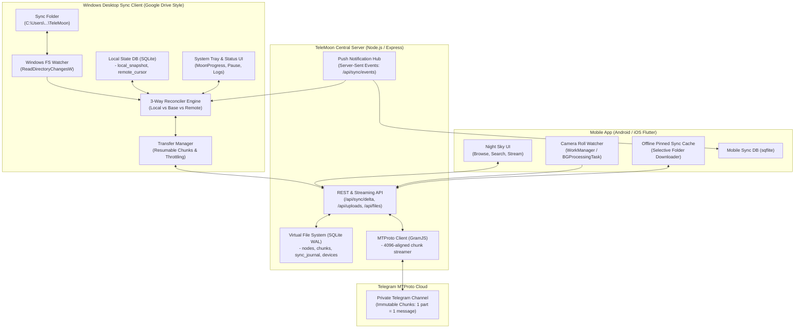
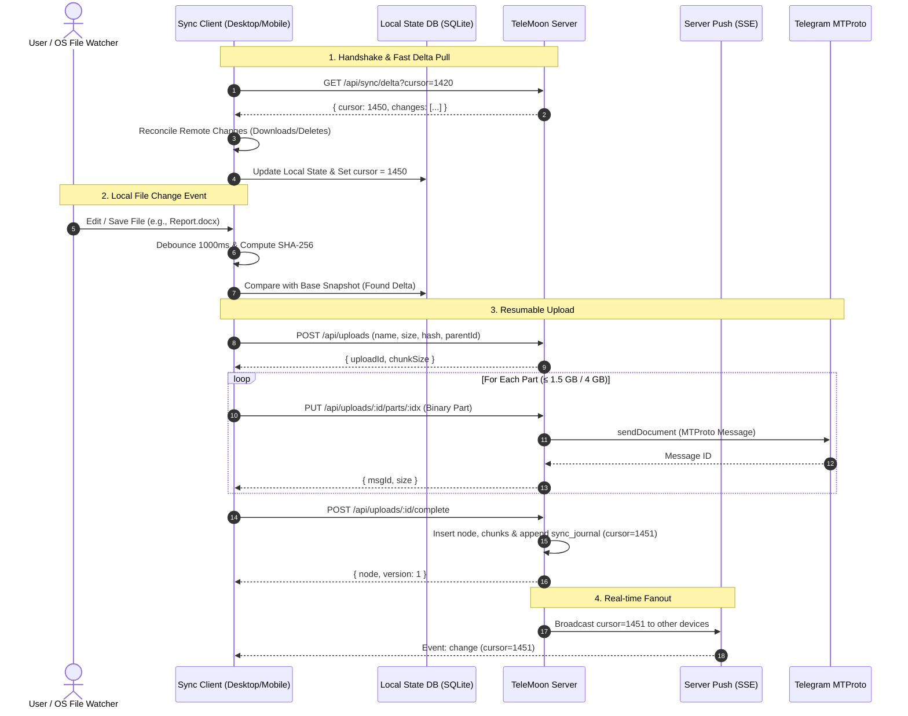

# 🌙 TeleMoon — Comprehensive Sync Architecture & Implementation Guide (`app.md`)

This document provides a complete review of the existing **TeleMoon** codebase, identifies the architectural gaps required to transition from a web-based cloud drive into a **bidirectional Google-Drive-style file sync platform**, and specifies the full system architecture for:
1. **The TeleMoon Backend Sync Engine** (Delta API, Change Journal, Real-time Events, Deduplication).
2. **The Windows Desktop Client** (File system watcher, 3-way reconciliation, conflict resolution, system tray, and on-demand sync).
3. **The Mobile App (Android & iOS)** (Camera roll auto-backup, offline pinned folders, battery/network aware background sync).

---

## 1. Codebase Review & Current State Analysis

### 1.1 Existing Architecture Summary
TeleMoon is currently built as a multi-tier web application that exploits Telegram's private channels via MTProto as an unlimited object storage backend:

```
┌─────────────────┐      HTTP / JSON API       ┌────────────────────────┐      MTProto (GramJS)      ┌─────────────────────────┐
│ React Web App   │ ─────────────────────────► │ Express Backend        │ ─────────────────────────► │ Telegram Private        │
│ [web/]          │   (Bearer JWT, chunk XHR)  │ [server/src/]          │   (≤1.5GB / 4GB parts)     │ Channel (Blob Storage)  │
└─────────────────┘                            │ - SQLite VFS (nodes)   │                            └─────────────────────────┘
┌─────────────────┐                            │ - Chunk mappings       │
│ Flutter App     │ ─────────────────────────► │ - User Auth & Sessions │
│ [app/] (WIP)    │                            └────────────────────────┘
└─────────────────┘
```

#### Codebase Components:
- **Backend ([`server/src/db.js`](file:///D:/Apps/2018/TeleMoon/server/src/db.js), [`server/src/routes.js`](file:///D:/Apps/2018/TeleMoon/server/src/routes.js), [`server/src/telegram.js`](file:///D:/Apps/2018/TeleMoon/server/src/telegram.js))**:
  - **Virtual File System (VFS)**: Maintained in SQLite (`data/telemoon.db`) with tables: `nodes` (folders and files), `chunks` (ordered MTProto message IDs and sizes), `uploads` & `upload_parts` (resumable multipart upload state), `users`, and `settings`.
  - **MTProto Engine**: Uses GramJS (`TelegramClient`) instead of Bot HTTP API, allowing up to 2 GB transfers per bot message and up to 4 GB per Telegram Premium user session.
  - **Streaming Downloads**: Supports HTTP Range headers (`streamRange`) across chunk boundaries, enabling seeking in media.
  - **Channel Auto-Indexing**: Background listener (`onChannelPost`) and historical sync (`syncChannelHistory`) index foreign documents dropped into the Telegram channel into a `/Telegram Inbox` folder.
- **Web Frontend ([`web/src/api.js`](file:///D:/Apps/2018/TeleMoon/web/src/api.js), [`web/src/Drive.jsx`](file:///D:/Apps/2018/TeleMoon/web/src/Drive.jsx))**:
  - Implements the "night sky" design token contract defined in [`design-principle.md`](file:///D:/Apps/2018/TeleMoon/design-principle.md).
  - Handles client-side chunking (`Blob.slice`), sequential upload with retry, and waxing-moon progress indicators.
- **Client App ([`app/lib/main.dart`](file:///D:/Apps/2018/TeleMoon/app/lib/main.dart), [`app/lib/api_service.dart`](file:///D:/Apps/2018/TeleMoon/app/lib/api_service.dart), [`app/lib/database_helper.dart`](file:///D:/Apps/2018/TeleMoon/app/lib/database_helper.dart))**:
  - A Flutter cross-platform project configured for Android, iOS, Windows, Linux, and macOS.
  - Currently contains basic screens: Auth, Link Storage (channel picker), and a read-only Drive grid.

---

### 1.2 Architectural Gap Analysis (Cloud Storage vs. Sync Engine)

To function like **Google Drive, Dropbox, or OneDrive**, a system cannot simply provide basic CRUD endpoints (`/nodes/:id/children`, `/uploads`). It requires a deterministic **bidirectional synchronization protocol**.

| Feature | Current TeleMoon Implementation | What a Google Drive Sync Engine Requires |
| :--- | :--- | :--- |
| **Change Tracking** | None. Clients must recursively re-fetch folders (`/nodes/:id/children`). | **Delta Change Journal (`sync_journal`)** with monotonic cursor. Clients query `changes?since_cursor=N` to get only delta additions, edits, moves, and deletes. |
| **Content Integrity & Dedup** | File sizes only. No cryptographic hashes. | **Content Hashing (`sha256` or xxHash64)** per file and per chunk to verify content changes vs metadata touches, and deduplicate uploads. |
| **Deletions** | Hard delete: rows are purged from SQLite and messages purged from Telegram. | **Tombstones / Soft Deletes (`deleted_at`)** in the change journal so sync clients know to delete local files rather than re-uploading them. |
| **Concurrency & Versions** | No version numbers or generation IDs. Last writer overwrites metadata. | **Generation / Revision counters (`version`)** and optimistic locking (`If-Match: <version>`) to detect conflicts. |
| **Real-time Push** | None. Manual page refresh. | **Server-Sent Events (SSE) or WebSockets** pushing change notifications immediately when another device uploads or edits. |
| **Local Change Detection** | None on clients. | **File System Watcher (`ReadDirectoryChangesW`)** with event debouncing, temporary file filtering, and atomic write detection. |
| **Local State Storage** | Simple local channel table in Flutter SQLite. | **Local Sync State DB** storing triplet: `(Local Path, Remote Node ID, Base Snapshot Hash)` to run 3-way reconciliation. |
| **Conflict Handling** | None. | **Automatic Conflict Branching** (`filename (Conflicted copy from Desktop 2026-10-23).ext`). |

---

## 2. Complete System Architecture



---

## 3. Backend Server Enhancements (Sync Protocol Layer)

### 3.1 Database Schema Additions ([`server/src/db.js`](file:///D:/Apps/2018/TeleMoon/server/src/db.js))

The server database needs three extensions:
1. Extended metadata on `nodes` (`hash`, `version`, `deleted_at`, `client_modified_at`).
2. A high-throughput append-only `sync_journal` table for cursor-based delta synchronization.
3. A `devices` table to track connected clients and prevent echo notifications.

```sql
-- 1. Upgrade 'nodes' table
ALTER TABLE nodes ADD COLUMN hash TEXT;                 -- SHA-256 of full file content
ALTER TABLE nodes ADD COLUMN version INTEGER DEFAULT 1; -- Monotonically increasing revision number
ALTER TABLE nodes ADD COLUMN client_modified_at INTEGER;-- Client filesystem mtime (ms)
ALTER TABLE nodes ADD COLUMN deleted_at INTEGER;        -- NULL = active, timestamp = soft deleted
ALTER TABLE nodes ADD COLUMN device_id TEXT;            -- Originating device ID

-- 2. Create 'sync_journal' table
CREATE TABLE IF NOT EXISTS sync_journal (
  cursor INTEGER PRIMARY KEY AUTOINCREMENT,
  node_id TEXT NOT NULL,
  user_id TEXT NOT NULL,
  action TEXT NOT NULL CHECK(action IN ('CREATE', 'UPDATE', 'MOVE', 'DELETE')),
  parent_id TEXT,
  name TEXT NOT NULL,
  type TEXT NOT NULL,
  size INTEGER NOT NULL,
  hash TEXT,
  version INTEGER NOT NULL,
  device_id TEXT,
  created_at INTEGER NOT NULL
);
CREATE INDEX IF NOT EXISTS idx_journal_user_cursor ON sync_journal(user_id, cursor);

-- 3. Create 'devices' table
CREATE TABLE IF NOT EXISTS devices (
  id TEXT PRIMARY KEY,
  user_id TEXT NOT NULL,
  name TEXT NOT NULL,
  platform TEXT NOT NULL CHECK(platform IN ('windows', 'android', 'ios', 'web', 'other')),
  last_cursor INTEGER NOT NULL DEFAULT 0,
  last_seen_at INTEGER NOT NULL,
  created_at INTEGER NOT NULL
);
```

### 3.2 Delta Sync & Push API Specification

#### 1. Delta Changes Feed: `GET /api/sync/delta`
Allows clients to retrieve all changes since their last known cursor.
- **Query Parameters**:
  - `cursor`: Integer (last synced cursor, default `0`).
  - `limit`: Integer (default `500`, max `1000`).
- **Response**:
```json
{
  "cursor": 1420,
  "hasMore": false,
  "changes": [
    {
      "cursor": 1419,
      "nodeId": "kX7a9b2M",
      "action": "CREATE",
      "parentId": "root",
      "name": "Project Roadmap.docx",
      "type": "file",
      "size": 1048576,
      "hash": "e3b0c44298fc1c149afbf4c8996fb92427ae41e4649b934ca495991b7852b855",
      "version": 1,
      "clientModifiedAt": 1792764120000,
      "deviceId": "win-desktop-01"
    },
    {
      "cursor": 1420,
      "nodeId": "mN4c1Z8y",
      "action": "DELETE",
      "parentId": "root",
      "name": "Old Draft.txt",
      "type": "file",
      "size": 0,
      "version": 4,
      "deviceId": "android-pixel-02"
    }
  ]
}
```

#### 2. Real-time Change Stream: `GET /api/sync/events` (SSE)
- Uses Server-Sent Events (SSE).
- Client connects with `Authorization: Bearer <JWT>` and header `Last-Event-ID: <cursor>`.
- Emits lightweight notifications whenever any change is recorded in `sync_journal`:
```
event: change
id: 1421
data: {"cursor": 1421, "nodeId": "kX7a9b2M", "action": "UPDATE", "deviceId": "win-desktop-01"}
```
- Client immediately triggers a delta pull to synchronize the exact diff without expensive polling.

#### 3. Upload Initialization with Hash Verification: `POST /api/uploads`
Extend the existing endpoint to include the client's SHA-256 hash:
- **Request Body**:
```json
{
  "name": "Document.pdf",
  "size": 25165824,
  "mime": "application/pdf",
  "parentId": "root",
  "hash": "4a5b6c...",
  "clientModifiedAt": 1792764120000,
  "deviceId": "win-desktop-01"
}
```
- **Instant Deduplication Optimization**: If a file node with identical `hash` and `size` already exists in the user's account, the server can link the existing chunk references immediately without re-uploading parts to Telegram!

---

## 4. Windows Desktop App Architecture (Google Drive Style)

The Windows application must run continuously as a background process or system tray application, mirroring a local folder (e.g., `C:\Users\<User>\TeleMoon`) with the cloud drive.

### 4.1 Technology Stack Selection
1. **Core Runtime**: Flutter Desktop (Windows) using the existing [`app/`](file:///D:/Apps/2018/TeleMoon/app) project, complemented by native Windows C++ plugins / Windows API bindings.
2. **Alternative Daemon Architecture (Recommended for Enterprise Stability)**:
   - **Background Sync Engine (Daemon)**: Written in **Rust** (or C# .NET 8) running as a quiet background process. Uses `notify-rs` (wrapping `ReadDirectoryChangesW`), `rusqlite`, and `reqwest`.
   - **Front-end UI**: Flutter Windows or Tauri communicating with the local daemon over a lightweight local IPC / WebSocket (`ws://127.0.0.1:41920`).

---

### 4.2 File System Watcher & Event Normalization
Windows file system events (`ReadDirectoryChangesW`) are notorious for bursting and emitting raw OS events that do not match high-level user actions.

#### The Event Normalizer Pipeline:
```
Raw OS Events (Create, Modify, Rename, Delete)
  │
  ▼
[Debounce Buffer (500ms - 1500ms)]  ──► Consolidates multiple rapid write events
  │
  ▼
[Ignore Filter (.telemoonignore)]   ──► Drops temp/lock files (.tmp, ~$, desktop.ini)
  │
  ▼
[File Lock Check]                   ──► Verifies file is closed and not locked by another process
  │
  ▼
[Hash & Size Verification]          ──► Verifies file content actually changed (avoids mtime-only triggers)
  │
  ▼
[Reconciliation Queue]
```

#### Ignore Rules (`.telemoonignore`):
- Office lock files: `~$*`, `.~lock.*`
- Windows system metadata: `desktop.ini`, `Thumbs.db`, `$RECYCLE.BIN`
- Development artifacts: `node_modules/`, `.git/`, `.dart_tool/`, `target/`, `*.tmp`
- TeleMoon internal cache: `.telemoon/`, `telemoon_state.db*`

---

### 4.3 Local State Database Schema (`telemoon_state.db`)
Maintained locally inside `C:\Users\<User>\TeleMoon\.telemoon\state.db`:

```sql
-- Represents the base snapshot (last known synced state between local and remote)
CREATE TABLE sync_entries (
  id TEXT PRIMARY KEY,               -- Remote node_id
  relative_path TEXT UNIQUE NOT NULL,-- e.g. "Documents/Finance/2026.xlsx"
  parent_id TEXT,                    -- Remote parent_id
  type TEXT NOT NULL,                -- 'file' | 'folder'
  size INTEGER NOT NULL,
  sha256 TEXT,                       -- Hash of file when last in sync
  local_mtime INTEGER NOT NULL,      -- Local OS last modified timestamp
  remote_version INTEGER NOT NULL,   -- Version on server
  sync_status TEXT NOT NULL,         -- 'synced', 'pending_upload', 'pending_download', 'conflict'
  last_sync_time INTEGER NOT NULL
);

CREATE TABLE sync_config (
  key TEXT PRIMARY KEY,
  value TEXT NOT NULL
);
-- Keys: last_cursor, server_url, token, local_root_path, selective_sync_folders
```

---

### 4.4 The 3-Way Reconciliation Algorithm

Every sync cycle reconciles three representations of the world:
1. **Local State ($L$)**: The actual files currently on the local disk.
2. **Base State ($B$)**: The record stored in `telemoon_state.db` from the previous sync.
3. **Remote State ($R$)**: The latest metadata fetched from `/api/sync/delta`.

| Local vs Base ($L = B$?) | Remote vs Base ($R = B$?) | Decision / Action |
| :---: | :---: | :--- |
| **Equal** | **Equal** | **No action**. File is clean and up to date. |
| **Modified** | **Equal** | **Local Edit**: Upload new file version to server, increment version. |
| **Equal** | **Modified** | **Remote Edit**: Download new file version from server, update local file & base. |
| **Deleted** | **Equal** | **Local Delete**: Send `DELETE /nodes/:id` to server. |
| **Equal** | **Deleted** | **Remote Delete**: Delete local file from disk and remove base entry. |
| **Modified** | **Modified** | **Conflict**: Check if $Hash(L) == Hash(R)$. If hashes match, auto-resolve! If hashes differ, trigger **Conflict Resolution**. |
| **New ($B$ is null)** | **Null** | **Local Add**: Create folder/upload file to server. |
| **Null** | **New ($B$ is null)** | **Remote Add**: Download new file to local disk. |
| **New ($B$ is null)** | **New ($B$ is null)** | **Name Collision**: Compare hashes. If identical, merge; if different, create conflict copy. |

#### Conflict Resolution Implementation:
When a conflict occurs:
1. Do **not** overwrite the local file.
2. Download the remote file under the original name: `Report.docx`.
3. Rename the local modified file with the conflict pattern:
   ```
   Report (Desktop conflicted copy 2026-10-23).docx
   ```
4. Upload the conflicted copy as a new file so the user never loses data.
5. Notify the user via Windows desktop toast notification.

---

### 4.5 System Tray & Windows Shell UX

#### UI Components (Built with Flutter Desktop):
1. **System Tray Icon**:
   - Idle / Synced: Dark blue/gold crescent moon (TeleMoon icon).
   - Syncing: Animated waxing moon (matching the web app's `MoonProgress`).
   - Paused: Gray crescent moon with pause bars.
   - Error / Attention: Crescent moon with small red dot.
2. **Context Menu / Tray Popup**:
   - Status header: "Up to date" or "Syncing 3 files (14.2 MB / 80.0 MB)".
   - Recent sync activity log (clickable files open in Windows Explorer).
   - "Open TeleMoon Folder" button.
   - "Pause sync" (for 30 min, 2 hours, or until resumed).
   - "Preferences": Selective sync folder selector, bandwidth speed limiter, startup with Windows (`HKEY_CURRENT_USER\Software\Microsoft\Windows\CurrentVersion\Run`).

#### Advanced Tier: Windows Cloud Files API (Virtual Placeholders)
*For a true Google Drive / OneDrive experience where files don't take up local disk space until opened:*
- Use the **Windows Cloud Filter API (`cfapi.h`)** or **Projected File System (ProjFS)**.
- Files appear in Explorer as normal files with cloud icons (pin states: *Online-only*, *Locally available*, *Always keep on this device*).
- When a user double-clicks an online-only file, the OS sends a callback to the TeleMoon daemon, which streams the MTProto chunks in real-time, hydrates the file, and hands it to the OS transparently.

---

## 5. Mobile App Architecture (Android & iOS)

Mobile devices operate under strict power, memory, and background execution limits. A mobile sync client must be tailored for battery efficiency and on-demand access.

### 5.1 Mobile Feature Matrix
1. **Virtual Drive Explorer**: Browse, search, preview, and stream files on demand (audio/video streaming via HTTP Range requests).
2. **Camera Roll Auto-Backup**: Automatically upload new photos and videos to `/Mobile Backup/<DeviceName>/<Year>/<Month>`.
3. **Pinned Offline Folders / Files**: User can toggle "Keep Offline" on specific folders/files. The app keeps these synchronized locally.
4. **Share Sheet Integration**: Send files from any app (WhatsApp, Gallery, Files) directly into TeleMoon.

---

### 5.2 Background Execution & Platform Constraints

```
┌────────────────────────────────────────────────────────┐
│                   Mobile Constraints                   │
├───────────────────────────┬────────────────────────────┤
│ Android                   │ iOS                        │
├───────────────────────────┼────────────────────────────┤
│ - Doze Mode & App Standby │ - Strict 30s background cap│
│ - Scoped Storage          │ - BGProcessingTask window  │
│ - Foreground Service with │ - Background URLSession for│
│   notification for uploads│   large chunk transfers    │
└───────────────────────────┴────────────────────────────┘
```

#### Android Implementation:
- **Periodic Checks**: Use Android `WorkManager` with `Constraints.Builder`:
  - `setRequiredNetworkType(NetworkType.UNMETERED)` (Wi-Fi only toggle).
  - `setRequiresCharging(true)` (Charge-only backup option).
  - `setRequiresBatteryNotLow(true)`.
- **Active Large Uploads**: Promote the upload task to a **Foreground Service** with an ongoing notification showing the Moon progress bar so Android does not kill the process.
- **Media Ingestion**: Register a `ContentObserver` on `MediaStore.Images.Media.EXTERNAL_CONTENT_URI`.

#### iOS Implementation:
- **Background Tasks Framework**:
  - Register `BGAppRefreshTask` (every 1-2 hours) for fast delta sync checks.
  - Register `BGProcessingTask` (runs overnight when connected to power and Wi-Fi) for heavy camera roll backup.
- **Background Transfers**: Use native `URLSessionConfiguration.backgroundSession` so uploads and downloads continue even when the app is suspended or terminated by the user.
- **Photos Observer**: Use `PHPhotoLibraryChangeObserver` to capture new asset additions.

---

### 5.3 Local Cache & Mobile Database Schema
In the Flutter mobile client ([`app/lib/database_helper.dart`](file:///D:/Apps/2018/TeleMoon/app/lib/database_helper.dart)), expand `sqflite`:

```sql
-- Cached remote file tree for offline browsing
CREATE TABLE cached_nodes (
  id TEXT PRIMARY KEY,
  parent_id TEXT,
  name TEXT NOT NULL,
  type TEXT NOT NULL,
  size INTEGER NOT NULL,
  mime TEXT,
  hash TEXT,
  version INTEGER NOT NULL,
  updated_at INTEGER NOT NULL
);

-- Offline pinned downloads
CREATE TABLE offline_items (
  node_id TEXT PRIMARY KEY,
  local_path TEXT NOT NULL,
  cached_version INTEGER NOT NULL,
  cached_hash TEXT NOT NULL,
  last_synced_at INTEGER NOT NULL
);

-- Camera roll backup tracking
CREATE TABLE photo_backup_log (
  local_asset_id TEXT PRIMARY KEY, -- Android media ID or iOS PHAsset localIdentifier
  remote_node_id TEXT NOT NULL,
  file_name TEXT NOT NULL,
  file_size INTEGER NOT NULL,
  backup_time INTEGER NOT NULL
);
```

---

## 6. End-to-End Sync Protocol & Algorithms

### 6.1 The Unified Sync Loop Sequence



### 6.2 High-Efficiency Large File Pipeline
Because TeleMoon stores files as individual Telegram messages (≤1.5GB/4GB per chunk), the sync client leverages this exact chunk structure:
1. **Parallel Chunking**: The client hashes the file while reading 1.5 GB chunks.
2. **Chunk Recovery**: If an upload is interrupted at part 3 of 5, the client re-queries the backend `/uploads/:id`, discovers parts 0, 1, and 2 are already stored in Telegram, and resumes directly at part 3.
3. **Zero RAM Pressure**: The desktop and mobile engines stream chunks directly from disk to network without buffering full files in memory.

---

## 7. Implementation Roadmap & Task Checklist

### Phase 1: Server Core Sync Engine (1–2 weeks)
- [ ] Add `hash`, `version`, `deleted_at`, and `client_modified_at` columns to `nodes` table in [`server/src/db.js`](file:///D:/Apps/2018/TeleMoon/server/src/db.js).
- [ ] Create `sync_journal` and `devices` tables with proper indexes.
- [ ] Implement `GET /api/sync/delta` endpoint with pagination in [`server/src/routes.js`](file:///D:/Apps/2018/TeleMoon/server/src/routes.js).
- [ ] Implement `GET /api/sync/events` (Server-Sent Events) for real-time notification broadcasting.
- [ ] Add SHA-256 calculation and deduplication check to `POST /api/uploads` and `POST /api/uploads/:id/complete`.
- [ ] Convert `DELETE /nodes/:id` to emit soft-delete tombstones in `sync_journal` before purging Telegram messages.

### Phase 2: Windows Desktop Client (2–3 weeks)
- [ ] Set up the Windows Sync Engine in [`app/`](file:///D:/Apps/2018/TeleMoon/app) (or as a companion daemon).
- [ ] Implement `ReadDirectoryChangesW` folder watcher with debouncing and `.telemoonignore` filtering.
- [ ] Build the local SQLite state database (`telemoon_state.db`).
- [ ] Implement the 3-Way Reconciliation State Machine (Local, Base, Remote).
- [ ] Build the conflict engine (generate conflicted copy files, notify user).
- [ ] Create the Windows System Tray menu with live sync status, pause/resume, and settings dialogs.
- [ ] Add Windows auto-start registry hook (`Run on boot`).

### Phase 3: Mobile App Sync & Polish (2–3 weeks)
- [ ] Expand the Flutter client in [`app/`](file:///D:/Apps/2018/TeleMoon/app) with background services (`workmanager`).
- [ ] Implement the Camera Roll Auto-Backup engine (Android MediaStore / iOS Photos).
- [ ] Add "Keep Offline" pinned folder synchronization with local cache storage.
- [ ] Add network constraint toggles: "Sync on Wi-Fi only" and "Sync only when charging".
- [ ] Implement SSE listener on mobile for real-time remote folder updates when app is open.

### Phase 4: Enterprise Hardening & Advanced Features (Roadmap)
- [ ] **Client-side AES-256-GCM Encryption**: Encrypt each chunk on client before upload; decrypt during streaming range download using user master passphrase.
- [ ] **Windows Cloud Files (Placeholders)**: Implement `cfapi` / ProjFS for zero-byte on-demand virtual files in Windows Explorer.
- [ ] **LAN Sync**: Discover other TeleMoon clients on the same local network (via mDNS) to sync files directly at gigabit speeds without re-downloading from Telegram.

---

> [!NOTE]
> This architecture maintains 100% backward compatibility with existing web uploads and MTProto invariants (`tm1;` caption protocol, 4096-byte chunk alignment, and SQLite VFS integrity). All file and folder operations remain end-to-end recoverable.
