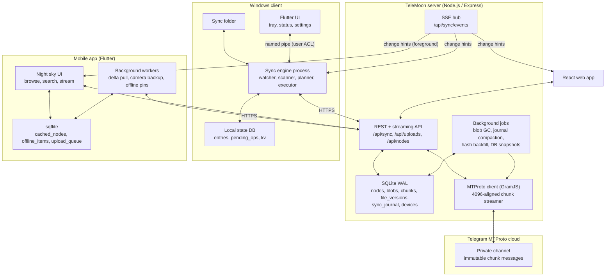

# 🌙 TeleMoon: Sync Architecture & Implementation Guide (`app.md`)

> **Status:** Proposed, v2 · **Last revised:** 2026-10-23
> **Scope:** Turning TeleMoon from a web cloud drive into a bidirectional, Google-Drive-style sync platform: server sync engine, Windows desktop client, Android/iOS app, and the web app changes that go with them.
> **Convention:** Items marked **(verify)** are assumptions about the current codebase that should be checked before implementation starts.

## Contents

1. [Summary](#1-summary)
2. [Current state & gap analysis](#2-current-state--gap-analysis)
3. [Design principles & invariants](#3-design-principles--invariants)
4. [System architecture](#4-system-architecture)
5. [Server: sync protocol layer](#5-server-sync-protocol-layer)
6. [Windows desktop client](#6-windows-desktop-client)
7. [Mobile app (Android & iOS)](#7-mobile-app-android--ios)
8. [Web app changes](#8-web-app-changes)
9. [Security & privacy](#9-security--privacy)
10. [Reliability, disaster recovery & Telegram risks](#10-reliability-disaster-recovery--telegram-risks)
11. [Testing strategy](#11-testing-strategy)
12. [Observability](#12-observability)
13. [Roadmap & acceptance criteria](#13-roadmap--acceptance-criteria)
14. [Open decisions](#14-open-decisions)

- [Appendix A: Changes from v1](#appendix-a-changes-from-v1)
- [Appendix B: Default configuration values](#appendix-b-default-configuration-values)

---

## 1. Summary

TeleMoon stores file content as immutable chunks (one chunk = one message) in a private Telegram channel, and keeps the folder tree, chunk mapping and users in a SQLite virtual file system (VFS). Today it is a request/response cloud drive. To behave like Google Drive, Dropbox or OneDrive it needs a **deterministic, crash-safe, bidirectional sync protocol**.

**Goals**

- Change-feed (delta) sync with a monotonic cursor, so clients never re-list the tree.
- No silent data loss: conflicts create copies, deletes go to trash, local deletes go to the Recycle Bin.
- A Windows client that mirrors a local folder and survives crashes, renames, Office "safe saves" and watcher overflows.
- A mobile client for browsing, streaming, offline pins and camera-roll backup within OS background limits.
- Full backward compatibility with the existing web app and MTProto invariants (`tm1;` caption protocol, 4096-byte chunk alignment, SQLite VFS integrity).

**Non-goals for this version:** multi-user sharing and permissions, server-side search, real-time collaborative editing.

**Headline decisions**

| Decision         | Choice                                                                                 | Why                                                         |
| :--------------- | :------------------------------------------------------------------------------------- | :---------------------------------------------------------- |
| Delta entries    | Idempotent **state snapshots** of a node, not commands                                 | Allows coalescing, safe replays, and out-of-order tolerance |
| Deletion         | Soft delete → trash → **GC job** is the only thing that deletes Telegram messages      | Required for undo, sync tombstones, and safe deduplication  |
| Content identity | New `blobs` layer (hash-addressed, per-user) between nodes and chunks                  | Dedup and versioning without dangling chunk references      |
| Concurrency      | `version` + `If-Match` / `baseVersion` checked **inside the commit transaction**       | Prevents lost updates between devices                       |
| Windows engine   | Pure **planner** (L, B, R → ops) + persisted **op queue** + executor                   | Testable, crash-safe, resumable                             |
| Conflicts        | Server never decides; the client keeps both versions                                   | No data loss, matches user expectations                     |
| Windows UI split | Sync engine as a background process, Flutter UI as a separate client over a named pipe | Sync keeps running when the UI is closed or crashes         |

---

## 2. Current state & gap analysis

### 2.1 What exists today

```
React Web App ──HTTP/JSON (JWT, chunk XHR)──► Express backend ──MTProto (GramJS)──► Telegram private channel
Flutter app (WIP) ─────────────────────────►  - SQLite VFS (nodes, chunks, uploads, users, settings)
```

- **Backend** ([`server/src/db.js`](server/src/db.js), [`server/src/routes.js`](server/src/routes.js), [`server/src/telegram.js`](server/src/telegram.js)): SQLite VFS with `nodes`, `chunks`, `uploads`/`upload_parts` (resumable multipart), `users`, `settings`. GramJS MTProto client. Range-capable streaming across chunk boundaries (`streamRange`). Channel auto-indexing (`onChannelPost`, `syncChannelHistory`) into `/Telegram Inbox`.
- **Web** ([`web/src/api.js`](web/src/api.js), [`web/src/Drive.jsx`](web/src/Drive.jsx)): "night sky" design tokens ([`design-principle.md`](design-principle.md)), client-side chunking with retry, waxing-moon progress.
- **Flutter app** ([`app/lib/main.dart`](app/lib/main.dart), [`app/lib/api_service.dart`](app/lib/api_service.dart), [`app/lib/database_helper.dart`](app/lib/database_helper.dart)): auth, channel picker, read-only drive grid.

### 2.2 Assumptions to verify before starting

1. `nodes` has a per-user owner column (written as `user_id` below) and the root is addressed by a sentinel such as `"root"` rather than `NULL` **(verify)**. This matters for the unique-name index in §5.2.
2. Existing data contains no names that collide case-insensitively within a folder **(verify; migration must resolve any that do)**.
3. `chunks` is keyed by `node_id` and ordered by index **(verify)**; §5.7 adds a `blob_id` layer on top.
4. Uploads are currently one HTTP request per Telegram part, with the part size chosen by the server **(verify)**.
5. What the `tm1;` caption actually encodes (node id, part index, size?). This determines whether the DB can be rebuilt from the channel (§10).
6. The server uses a single SQLite writer (e.g. `better-sqlite3`), which §5.3 relies on for cursor ordering **(verify)**.

### 2.3 Gap analysis

| Capability             | Today                                           | Needed                                                                                  |
| :--------------------- | :---------------------------------------------- | :-------------------------------------------------------------------------------------- |
| Change tracking        | None; clients recursively re-list               | **`sync_journal`** with monotonic cursor, coalesced delta feed, retention + resync path |
| Content identity       | Size only                                       | **SHA-256** per file; per-part hashes for transfer verification                         |
| Deletion               | Hard delete (rows and Telegram messages purged) | **Soft delete + trash + GC**; tombstones in the journal                                 |
| Concurrency            | Last writer wins                                | **`version` + optimistic locking** enforced at commit                                   |
| Dedup                  | None                                            | Per-user **blob** reuse, reference-safe                                                 |
| Moves / renames        | Not first-class                                 | `MOVE` action, a single entry for a whole subtree move                                  |
| Real-time              | None                                            | **SSE** hints + delta pull (and push notifications later for mobile)                    |
| Idempotency            | Retries may duplicate                           | `Idempotency-Key` on mutating calls; deterministic upload resume                        |
| Local change detection | None                                            | Watcher + periodic rescan + file IDs for rename detection                               |
| Local state            | Channel table only                              | Persisted **entries** (base/remote/local) + **op queue**                                |
| Conflict handling      | None                                            | Conflicted copies, edit-beats-delete rules, user notification                           |
| Platform edge cases    | None                                            | Windows name/path rules, case-insensitivity, Unicode normalization                      |
| Safety rails           | None                                            | Mass-delete guard, root-missing guard, disk-space checks                                |
| Recovery               | DB is a single point of failure                 | Scheduled DB snapshots, rebuild tool, GC grace periods                                  |

---

## 3. Design principles & invariants

These are testable. §11 turns them into automated checks.

1. **Atomic journaling.** Every mutation of `nodes` and its `sync_journal` append happen in the **same SQLite transaction**. SSE notifications are sent only after commit.
2. **Idempotent everything.** A delta entry describes the _current state_ of a node; applying it twice is harmless. Mutating requests carry an `Idempotency-Key`. Retries never create duplicates.
3. **No silent data loss.**
   - Remote edit vs local edit → keep both (conflicted copy).
   - Edit vs delete → the edit wins (the file is resurrected).
   - Remote deletes land in the **Recycle Bin**; local deletes land in the server **trash**.
4. **Server defines order; clients never trust clocks.** Ordering and conflict detection use `version` and `cursor`. Client `mtime` is metadata only.
5. **Chunks are immutable and only GC deletes them.** Telegram messages are removed solely by the blob GC job after the retention period and only when no node or version references the blob.
6. **Remote names are untrusted input.** Clients validate and sanitize every name and path before touching the filesystem.
7. **Cursor-based clients are stateless about history.** If a client's cursor is too old, it resyncs from a snapshot (§5.3); correctness never depends on unbounded journal retention.
8. **Engine logic is pure and testable.** The planner is a function of (local, base, remote) → ops, with no I/O.

---

## 4. System architecture



**Important consequence:** every byte flows **through the TeleMoon server** (client ⇄ server ⇄ Telegram). Server bandwidth, disk staging (if any), and Telegram flood limits are therefore the system's real throughput ceiling, not the clients. Capacity planning and rate limiting belong to the server design, not an afterthought.

---

## 5. Server: sync protocol layer

### 5.1 Data model overview

```
users ─┬─ devices
       ├─ nodes ──► blob_id ──► blobs ──► chunks (ordered Telegram message ids)
       │     └───► file_versions (history, one row per committed version)
       └─ sync_journal (append-only change log)
```

- **node**: a file or folder in the tree; `version` increments on every committed change (content, rename, move, delete, restore).
- **blob**: immutable content identified by `(user_id, sha256, size)`. Many nodes/versions may reference one blob.
- **chunk**: one Telegram message belonging to a blob.
- **journal entry**: records that a node changed, with the node's full resulting state.

### 5.2 Schema migration

Run migrations with `PRAGMA user_version` and one transaction per step. Take a DB snapshot first (§10).

```sql
-- Step 1: additive columns on nodes
ALTER TABLE nodes ADD COLUMN hash TEXT;                              -- SHA-256 hex of full content (denormalized from blobs)
ALTER TABLE nodes ADD COLUMN version INTEGER NOT NULL DEFAULT 1;     -- bumps on every committed change
ALTER TABLE nodes ADD COLUMN client_modified_at INTEGER;             -- client mtime (ms); metadata only, never used for ordering
ALTER TABLE nodes ADD COLUMN deleted_at INTEGER;                     -- NULL = live, else trashed at (ms)
ALTER TABLE nodes ADD COLUMN blob_id TEXT;                           -- current content (files only)

-- Step 2: blobs and versions
CREATE TABLE IF NOT EXISTS blobs (
  id              TEXT PRIMARY KEY,
  user_id         TEXT NOT NULL,
  sha256          TEXT,                       -- NULL until known
  size            INTEGER NOT NULL,
  verified        INTEGER NOT NULL DEFAULT 0, -- 1 = server confirmed sha256 over the stored bytes
  created_at      INTEGER NOT NULL,
  unreferenced_at INTEGER                     -- set by GC when no node/version references it
);
-- Only verified blobs are dedup targets.
CREATE UNIQUE INDEX IF NOT EXISTS idx_blobs_dedup
  ON blobs(user_id, sha256, size) WHERE sha256 IS NOT NULL AND verified = 1;

ALTER TABLE chunks ADD COLUMN blob_id TEXT;

CREATE TABLE IF NOT EXISTS file_versions (
  node_id            TEXT    NOT NULL,
  version            INTEGER NOT NULL,
  blob_id            TEXT    NOT NULL,
  size               INTEGER NOT NULL,
  hash               TEXT,
  client_modified_at INTEGER,
  device_id          TEXT,
  created_at         INTEGER NOT NULL,
  PRIMARY KEY (node_id, version)
);

-- Step 3: unique live names, case-insensitive (safe for Windows and macOS clients).
-- NOTE: SQLite treats NULLs as distinct in unique indexes, so the root MUST be a
-- sentinel value (e.g. 'root'), not NULL. Resolve existing collisions before creating.
CREATE UNIQUE INDEX IF NOT EXISTS idx_nodes_live_name
  ON nodes(user_id, parent_id, name COLLATE NOCASE) WHERE deleted_at IS NULL;

-- Step 4: journal and devices
CREATE TABLE IF NOT EXISTS sync_journal (
  cursor             INTEGER PRIMARY KEY AUTOINCREMENT,
  user_id            TEXT    NOT NULL,
  node_id            TEXT    NOT NULL,
  action             TEXT    NOT NULL CHECK (action IN ('CREATE','UPDATE','MOVE','DELETE','RESTORE')),
  parent_id          TEXT,
  name               TEXT    NOT NULL,
  type               TEXT    NOT NULL CHECK (type IN ('file','folder')),
  size               INTEGER NOT NULL DEFAULT 0,
  hash               TEXT,
  version            INTEGER NOT NULL,
  client_modified_at INTEGER,
  device_id          TEXT,
  created_at         INTEGER NOT NULL
);
CREATE INDEX IF NOT EXISTS idx_journal_user_cursor ON sync_journal(user_id, cursor);
CREATE INDEX IF NOT EXISTS idx_journal_user_node   ON sync_journal(user_id, node_id, cursor);

CREATE TABLE IF NOT EXISTS devices (
  id           TEXT PRIMARY KEY,
  user_id      TEXT NOT NULL,
  name         TEXT NOT NULL,
  platform     TEXT NOT NULL CHECK (platform IN ('windows','android','ios','web','other')),
  app_version  TEXT,
  last_cursor  INTEGER NOT NULL DEFAULT 0,
  last_seen_at INTEGER NOT NULL,
  created_at   INTEGER NOT NULL,
  revoked_at   INTEGER
);
```

**Backfill (background, resumable):**

1. Create one `blob` per existing file node, set `chunks.blob_id`, `nodes.blob_id`, and a `file_versions` row for version 1.
2. Seed the journal with one `CREATE` per live node so that `cursor=0` yields the whole tree. Order doesn't matter, because clients treat entries as upserts.
3. Hash backfill: hashing existing files means streaming them back from Telegram, which is slow and rate-limited. Run it as a throttled background job. `hash` stays `NULL` until done; clients treat `NULL` as "unknown" and fall back to size + mtime comparison.
4. Switch `DELETE` to soft delete only after steps 1–3 are in production.

### 5.3 Delta feed

#### `GET /api/sync/delta?cursor=<n>&limit=<n>`

- `limit` defaults to 500 (max 1000).
- Returns the **latest** journal entry per node with `cursor > n` (coalescing), ordered by cursor.
- Cursors are opaque, monotonic, and may have gaps. Clients must not do arithmetic on them.

```json
{
  "cursor": 1450,
  "hasMore": false,
  "changes": [
    {
      "cursor": 1419,
      "nodeId": "kX7a9b2M",
      "action": "UPDATE",
      "parentId": "root",
      "name": "Project Roadmap.docx",
      "type": "file",
      "size": 1048576,
      "hash": "e3b0c44298fc1c149afbf4c8996fb92427ae41e4649b934ca495991b7852b855",
      "version": 3,
      "deleted": false,
      "clientModifiedAt": 1792764120000,
      "deviceId": "win-desktop-01"
    },
    {
      "cursor": 1420,
      "nodeId": "mN4c1Z8y",
      "action": "DELETE",
      "parentId": "root",
      "name": "Old Draft.txt",
      "type": "file",
      "size": 0,
      "version": 4,
      "deleted": true,
      "deviceId": "android-pixel-02"
    }
  ]
}
```

**Semantics (clients must implement these)**

- **Entries are state, not commands.** Because of coalescing, a client may receive `UPDATE` for a node it has never seen. Treat every entry as an upsert of `nodeId → state`; `action` is a hint for UI only.
- **Returned `cursor`** is the cursor of the last entry returned; when `hasMore` is `false` it is the journal head at read time (read the head and the entries in one transaction).
- **Folder deletes and moves are single entries.** Descendants are implicitly deleted/moved with their folder. Clients apply the change to the subtree and never expect per-descendant entries.
- **No client-side echo filtering by `deviceId`.** The originating device ignores entries whose `(nodeId, version)` already matches its stored state. `deviceId` is for UI ("edited from Pixel 7"), not logic.
- **SQLite ordering note.** With a single SQLite writer, cursor order equals commit order. If the server ever moves to a multi-writer database, cursor allocation and visibility must be redesigned (in-flight lower cursors can commit after higher ones are visible).

#### Retention and resync

- Keep journal entries for **90 days** (configurable), and never compact past the oldest _active_ device's `last_cursor`, subject to that same 90-day cap.
- Compaction keeps only the latest entry per node for cursors below the retention horizon, and records `min_retained_cursor`.
- If a client sends `cursor < min_retained_cursor`, respond **`410 Gone`** with `{ "error": { "code": "RESYNC_REQUIRED" } }`.

#### `GET /api/sync/snapshot?after=<nodeId>&limit=<n>`

Used for first sync and resync. The first call returns `snapshotCursor` (the journal head at that moment). The client pages through all live nodes, then calls `delta?cursor=<snapshotCursor>`. Because delta entries are idempotent upserts, changes made _during_ the snapshot walk are reconciled correctly.

### 5.4 Write API

All mutating endpoints accept an `Idempotency-Key` header (stored for 24 h) and return the resulting node state, including `version`.

#### 5.4.1 Uploads: `POST /api/uploads`

```json
{
  "name": "Document.pdf",
  "size": 25165824,
  "mime": "application/pdf",
  "parentId": "root",
  "hash": "4a5b6c…",
  "clientModifiedAt": 1792764120000,
  "deviceId": "win-desktop-01",
  "replaceNodeId": null,
  "baseVersion": null,
  "onNameConflict": "fail"
}
```

- `hash` is **optional** (web uploads often can't compute it cheaply); the server computes it during upload either way (§5.7).
- `replaceNodeId` + `baseVersion` = "upload a new version of this file". The commit fails with `409 VERSION_CONFLICT` if the node's current `version != baseVersion`.
- `onNameConflict`: `fail` (default for sync clients, returns `409 NAME_CONFLICT`) or `rename` (web, server appends ` (1)`).
- **Dedup hit:** if a _verified_ blob with identical `(user_id, sha256, size)` exists, the server creates or updates the node to point at that blob and responds `200 { "dedup": true, "node": {…} }` with no part uploads. Dedup is **per-user only**; never cross-account.
- Otherwise: `{ "uploadId": "…", "chunkSize": …, "dedup": false }`.

#### 5.4.2 Parts and completion

- `PUT /api/uploads/:id/parts/:idx` with header `X-Part-SHA256`. The server verifies the part hash, writes the Telegram message, and stores the message id.
- `GET /api/uploads/:id` returns received parts so an interrupted client resumes at the first missing part.
- `POST /api/uploads/:id/complete` runs **one transaction**:
  1. Check `baseVersion` (if any) and name uniqueness.
  2. Insert or update the node, set `blob_id`, bump `version`.
  3. Insert the `file_versions` row.
  4. Append the `sync_journal` entry.

  Commit, then emit the SSE hint.

#### 5.4.3 Metadata operations

| Endpoint                                                            | Behavior                                                                             |
| :------------------------------------------------------------------ | :----------------------------------------------------------------------------------- |
| `POST /api/folders` `{parentId, name}`                              | Idempotent create-or-return by `(parent, name)`                                      |
| `PATCH /api/nodes/:id` `{name?, parentId?}` + `If-Match: <version>` | Rename/move; `MOVE` journal entry; rejects cycles and name collisions                |
| `DELETE /api/nodes/:id` + optional `If-Match`                       | **Soft delete** (`deleted_at`), `DELETE` entry; no Telegram call                     |
| `POST /api/nodes/:id/restore`                                       | Clears `deleted_at`, `RESTORE` entry; resolves name collisions by renaming           |
| `DELETE /api/trash/:id`                                             | Marks the blob(s) eligible for GC immediately (still subject to the reference check) |
| `GET /api/nodes/:id/versions`                                       | Version history (for restore and UI)                                                 |

Names are normalized to **Unicode NFC** on write and compared case-insensitively. Reject empty names, names containing `/`, `\`, or control characters, and names over 255 UTF-8 bytes.

#### 5.4.4 Block-level resumability (recommended extension)

Parts can be up to ~1.5 GB (Telegram message limit), which is impractical over mobile networks: an interruption at 90% of a part restarts that whole part. Proposed addition:

- `PUT …/parts/:idx` accepts `Content-Range: bytes <start>-<end>/<partSize>` with blocks of **8 MiB** (configurable). The server stages blocks on disk and sends the part to Telegram once complete.
- `GET /api/uploads/:id` reports received byte ranges per part.
- **Trade-off:** requires server staging disk (≈ `chunkSize × concurrent uploads`). Decide per §14. Mobile benefits most; desktop benefits from faster resume.

### 5.5 Real-time hints: `GET /api/sync/events` (SSE)

- Event payloads are **hints only**; the source of truth is always `delta`. They carry just the cursor:

```
event: change
id: 1451
data: {"cursor":1451}

: heartbeat
```

- **Auth:** the browser `EventSource` cannot set an `Authorization` header. Browsers use a short-lived single-use ticket (`POST /api/sync/events/ticket` → `?ticket=…`); native clients may use a normal Bearer header with a streaming HTTP request.
- **Resume:** honor `Last-Event-ID` by replaying from the journal; if too old, send `event: resync` and the client does a delta/snapshot pull.
- **Operational:** heartbeat comment every 25 s, `Cache-Control: no-cache`, `X-Accel-Buffering: no`, no response compression, per-user connection cap, emit only after the transaction commits.
- **Mobile background:** SSE only helps while the app is in the foreground. Background wake-ups require FCM/APNs pushes carrying only "something changed" (a future optional enhancement; iOS silent pushes are best-effort).

### 5.6 Errors, rate limits

```json
{ "error": { "code": "VERSION_CONFLICT", "message": "Node changed since baseVersion", "retryable": false, "current": { "version": 5, "hash": "…" } } }
```

| HTTP | Code                               | Client behavior                                                  |
| :--- | :--------------------------------- | :--------------------------------------------------------------- |
| 409  | `VERSION_CONFLICT`                 | Re-pull delta, replan (usually → conflict path)                  |
| 409  | `NAME_CONFLICT`                    | Re-pull delta, replan (compare hashes; adopt or conflicted copy) |
| 410  | `RESYNC_REQUIRED`                  | Snapshot resync                                                  |
| 410  | `UPLOAD_EXPIRED`                   | Start a new upload                                               |
| 422  | `HASH_MISMATCH`                    | Retry the part; if it repeats, re-hash the source file           |
| 429  | `RATE_LIMITED`                     | Honor `Retry-After` (also surfaces Telegram flood waits)         |
| 401  | `TOKEN_EXPIRED` / `DEVICE_REVOKED` | Refresh, or re-authenticate, or wipe local tokens                |
| 507  | `QUOTA_EXCEEDED`                   | Pause uploads, notify the user                                   |

### 5.7 Hashing, deduplication, blob lifecycle, GC

**Hash verification.** The server streams every uploaded byte, so it computes per-part SHA-256 and, when parts arrive in order, the whole-file SHA-256 incrementally. If the client-asserted `hash` differs from the server-computed hash, the upload fails with `HASH_MISMATCH`. Blobs are marked `verified = 1` only when the server computed the hash itself. Out-of-order parallel part uploads leave the blob unverified until a background verify job re-streams it; unverified blobs are never dedup targets.

**Why per-user dedup only.** Cross-account dedup leaks existence of other users' files to anyone who can guess a hash, and creates cross-account deletion coupling.

**Reference-safe deletion.** A blob is _referenced_ if any `nodes.blob_id` or `file_versions.blob_id` points at it. Compute references with a query; do not maintain a counter (counters drift). The GC job:

1. Finds blobs with zero references and sets `unreferenced_at` if unset.
2. After the grace period (default **30 days** since `unreferenced_at`; trash retention is 30 days), re-checks references **inside a transaction**.
3. Deletes the Telegram messages (rate-limited, retry-safe, idempotent: "message not found" counts as success), then deletes the `chunks` and `blobs` rows.

**Version retention.** Keep the latest N versions (default 10) or 30 days, whichever retains more; older `file_versions` rows are dropped, which can make blobs unreferenced.

---

## 6. Windows desktop client

### 6.1 Technology & process model

**Recommendation:** split the client into two processes.

| Process         | Responsibility                                             | Tech                                                                                                                                                          |
| :-------------- | :--------------------------------------------------------- | :------------------------------------------------------------------------------------------------------------------------------------------------------------ |
| **Sync engine** | Watcher, scanner, planner, executor, state DB, auth tokens | **Rust** (`notify`/`ReadDirectoryChangesW`, `rusqlite`, `reqwest`, `windows` crate). Dart-only is a viable fallback if Rust is rejected (§14), but see below. |
| **UI**          | Tray icon, popup, settings, toasts                         | Existing Flutter Windows app in [`app/`](app/)                                                                                                                |

Why split: sync must continue when the UI is closed or crashes; watcher buffer handling, file IDs, long paths and Recycle Bin integration are easier and more predictable in a native engine; and the engine can later be reused for the Cloud Files mode (§6.9).

**IPC:** a **named pipe** (`\\.\pipe\telemoon-<user-sid>`) with an ACL restricting access to the current user. The v1 proposal of `ws://127.0.0.1:41920` is not recommended: any local process or web page (via DNS rebinding) can reach a localhost port. If a localhost transport is unavoidable, require a per-session random token.

**Autostart:** `HKCU\Software\Microsoft\Windows\CurrentVersion\Run`, engine launched with `--background`. Ship a **code-signed** installer (MSIX or MSI) with signed auto-updates; unsigned binaries trigger SmartScreen.

### 6.2 Local data layout

| Item                     | Location                                       | Notes                                                                                |
| :----------------------- | :--------------------------------------------- | :----------------------------------------------------------------------------------- |
| Sync root                | `C:\Users\<User>\TeleMoon` (configurable)      | User-visible folder                                                                  |
| State DB, logs, config   | `%LOCALAPPDATA%\TeleMoon\<accountId>\`         | Moved out of the sync root so moving or deleting the folder can't destroy sync state |
| Staging (temp downloads) | `<sync root>\.telemoon-tmp\` (hidden, ignored) | Must be on the **same volume** as the destination so the final move is atomic        |
| Tokens                   | **Windows Credential Manager / DPAPI**         | Never in the state DB                                                                |

### 6.3 Change detection pipeline

```
Watcher (ReadDirectoryChangesW)         Full scanner
  │  raw events                           │  startup, watcher overflow, every 6 h
  ▼                                       ▼
[Ignore filter] ───────────────► [Dirty-path set]
                                          │  debounce 750 ms per path (quiet period)
                                          ▼
                          [Stat + file ID + lock probe]
                                          │  (size, mtime, fileId) unchanged? → skip hashing
                                          ▼
                              [Hash if needed (streaming SHA-256)]
                                          ▼
                          Update `local_*` columns → trigger planner
```

Key rules:

- **Watcher is a hint, scanner is the truth.** `ReadDirectoryChangesW` can overflow its buffer or drop events (network drives, bulk operations, sleep/resume). On overflow, error, resume-from-sleep, or startup, run a **full scan**. Also run a periodic full scan as a safety net.
- **Self-event suppression.** Before the executor writes, moves or deletes a path, register it in an "expected events" map `(path → expected state, TTL)`. Watcher events matching it are dropped. Without this, downloads trigger uploads in an infinite loop.
- **Hash caching.** Re-hash only when `(size, mtime_ns, fileId)` changed. Hash streaming, never loading whole files into memory.
- **Lock handling.** Probe by opening with share-read. If the file is locked or still being written, back off exponentially (1 s → 60 s) rather than failing.
- **Office safe-save and atomic-replace patterns** (write temp → delete original → rename temp) look like delete + create. The debounce window plus rename-over-existing handling must collapse these to a single _modify_.
- **Rename/move detection** uses the NTFS **file ID** (`volumeSerial + fileId`) stored per entry. If the base path is gone but the same file ID appears elsewhere, it is a **move**, not delete + upload. Fallback when IDs are unavailable: same size + hash, disappeared and appeared in the same cycle.

**Ignore rules (`.telemoonignore`, with built-in defaults):**

- Office/editor locks: `~$*`, `.~lock.*`, `*.swp`
- Windows metadata: `desktop.ini`, `Thumbs.db`, `$RECYCLE.BIN`, `System Volume Information`
- Dev artifacts (opt-out in settings): `node_modules/`, `.git/`, `.dart_tool/`, `target/`, `*.tmp`
- Internal: `.telemoon-tmp/`
- Placeholders/reparse points and symlinks: skipped by default (never follow into directory junctions).

### 6.4 Local state database

```sql
-- One row per tracked file/folder. "base" = last state both sides agreed on.
CREATE TABLE entries (
  entry_id        INTEGER PRIMARY KEY,
  node_id         TEXT UNIQUE,                 -- NULL for local-only items not yet uploaded
  type            TEXT NOT NULL CHECK (type IN ('file','folder')),

  base_parent_id  TEXT,  base_name TEXT,  base_version INTEGER,  base_hash TEXT,  base_size INTEGER,

  remote_parent_id TEXT, remote_name TEXT, remote_version INTEGER, remote_hash TEXT, remote_size INTEGER,
  remote_deleted  INTEGER NOT NULL DEFAULT 0,

  local_rel_path  TEXT,                        -- path as it exists on disk (sanitized, §6.6)
  local_file_id   TEXT,                        -- volumeSerial:fileId
  local_size      INTEGER, local_mtime_ns INTEGER, local_hash TEXT,
  local_present   INTEGER NOT NULL DEFAULT 0,

  excluded        INTEGER NOT NULL DEFAULT 0,  -- selective sync
  status          TEXT NOT NULL DEFAULT 'synced'
                  CHECK (status IN ('synced','pending','conflict','error','unsyncable')),
  status_detail   TEXT,
  updated_at      INTEGER NOT NULL
);
CREATE UNIQUE INDEX idx_entries_local_path ON entries(local_rel_path COLLATE NOCASE) WHERE local_rel_path IS NOT NULL;

-- Durable work queue: the planner appends, the executor drains. Survives crashes.
CREATE TABLE pending_ops (
  op_id           INTEGER PRIMARY KEY,
  entry_id        INTEGER NOT NULL,
  kind            TEXT NOT NULL,               -- UPLOAD, DOWNLOAD, MKDIR_LOCAL, MKDIR_REMOTE, MOVE_LOCAL,
                                               -- MOVE_REMOTE, DELETE_LOCAL, DELETE_REMOTE, ADOPT, CONFLICT
  payload         TEXT NOT NULL,               -- JSON (expected versions, upload id, temp path, …)
  idempotency_key TEXT NOT NULL,
  attempts        INTEGER NOT NULL DEFAULT 0,
  next_attempt_at INTEGER NOT NULL DEFAULT 0,
  created_at      INTEGER NOT NULL
);

CREATE TABLE kv (key TEXT PRIMARY KEY, value TEXT NOT NULL);
-- Keys: last_cursor, device_id, server_url, local_root_path, root_volume_serial,
--       root_file_id, last_full_scan_at, selective_sync (JSON)
```

**Ordering rule for the cursor:** persist the remote changes into `entries.remote_*` **and** advance `last_cursor` in a _single_ transaction. The planner then works from the DB, so a crash between "received" and "applied" loses nothing.

### 6.5 Reconciliation

#### Planner contract

`plan(entries) → ops[]` is a **pure function** (no I/O). Ordering of the resulting ops:

1. Moves first (local and remote renames).
2. Folder creates, parents before children.
3. File transfers (uploads/downloads).
4. Deletes, children before parents.

**Moves are resolved before content decisions:** a remote `MOVE` (same `nodeId`, new parent/name) becomes a local rename with no re-download; a locally detected move becomes `PATCH /api/nodes/:id` with `If-Match`.

#### Decision matrix for files (base exists)

_Local:_ **same** = unchanged vs base, **mod** = content changed, **del** = missing. _Remote:_ same for `remote_version == base_version`.

| Local | Remote | Action                                                                                   |
| :---: | :----: | :--------------------------------------------------------------------------------------- |
| same  |  same  | Nothing                                                                                  |
|  mod  |  same  | **Upload** new version with `baseVersion = base_version`                                 |
| same  |  mod   | **Download** to staging, verify hash, atomic replace, update base                        |
|  del  |  same  | `DELETE` remote (soft delete)                                                            |
| same  |  del   | Move local file to the **Recycle Bin**, drop the entry                                   |
|  mod  |  mod   | If `local_hash == remote_hash` → **adopt** (update base only). Else **conflict** (below) |
|  del  |  del   | Drop the entry                                                                           |
|  mod  |  del   | **Edit beats delete:** re-upload the local file as a new node (or `RESTORE` + upload)    |
|  del  |  mod   | **Edit beats delete:** download the remote version again                                 |

#### Decision matrix (no base entry)

|  Local  | Remote  | Action                                                                                                                      |
| :-----: | :-----: | :-------------------------------------------------------------------------------------------------------------------------- |
| present | absent  | **Upload** (create)                                                                                                         |
| absent  | present | **Download** (create)                                                                                                       |
| present | present | Same type and `local_hash == remote_hash` → **adopt**. Different hash, or **file vs folder** mismatch → **conflicted copy** |

#### Folders

- Remote folder delete: before removing the local subtree, check each local file against base. Anything locally **modified or new** is preserved: recreate its folder path under the nearest surviving ancestor and re-upload (edit beats delete). The rest goes to the Recycle Bin.
- Local folder delete: if any remote descendant changed after base (`remote_version > base_version`), expand to **per-file operations** and keep (re-download) the changed files; otherwise a single remote `DELETE` of the folder.
- Folders have no content; they conflict only on **name** or **type**.

#### Conflict procedure (order matters; each step is a durable op)

1. **Atomically rename** the local file to `Report (Desktop conflicted copy 2026-10-23).docx` (use device name + local date; append ` 2`, ` 3`, … on collision; never nest the suffix).
2. Create an entry for the conflicted copy as a _new local file_.
3. **Download** the remote version to the original name (via staging).
4. **Upload** the conflicted copy as a new node.
5. Raise a toast and a persistent entry in the activity list ("Conflict: Report.docx, both versions kept").

Renaming the local file _first_ means a crash at any point leaves the user's version safely intact under some name.

### 6.6 Windows filesystem edge cases

| Problem                                                                                                                                         | Policy                                                                                                                                                                                                                                                               |
| :---------------------------------------------------------------------------------------------------------------------------------------------- | :------------------------------------------------------------------------------------------------------------------------------------------------------------------------------------------------------------------------------------------------------------------- |
| Names Windows forbids: `< > : " / \ \| ? *`, control chars, trailing space/dot, reserved names (`CON`, `PRN`, `AUX`, `NUL`, `COM1–9`, `LPT1–9`) | Deterministic **sanitization** (replace char with `_`, add short stable suffix on collision). Store `remote_name` and `local_rel_path` separately; **never** rename the remote. Mark `unsyncable` only if sanitization is impossible. Show affected files in the UI. |
| Names containing `:` could address NTFS alternate data streams                                                                                  | Covered by the rule above; also reject any remote name that is `.` or `..`, absolute, or contains path separators (path-traversal defense).                                                                                                                          |
| Paths > 260 chars                                                                                                                               | Declare `longPathAware` in the manifest and use the `\\?\` prefix internally; warn in UI because some apps still fail past 260.                                                                                                                                      |
| Case-insensitivity                                                                                                                              | Server enforces case-insensitive uniqueness (§5.2). Case-only renames (`a.txt` → `A.txt`) are real renames and must go through a temp name locally.                                                                                                                  |
| Unicode normalization                                                                                                                           | Compare and store NFC; the server normalizes to NFC.                                                                                                                                                                                                                 |
| Timestamps                                                                                                                                      | After downloading, set local mtime to `clientModifiedAt`. Never decide anything from mtime alone. Tolerate DST changes and clock skew.                                                                                                                               |
| Sparse/placeholder/reparse files, symlinks                                                                                                      | Skip by default; surface in the UI.                                                                                                                                                                                                                                  |
| Antivirus / indexer locks                                                                                                                       | Retry with backoff (§6.3).                                                                                                                                                                                                                                           |
| Low disk space                                                                                                                                  | Check free space before downloads; pause with a notification below a threshold (default 1 GB free).                                                                                                                                                                  |

### 6.7 Safety valves

- **Mass-delete guard:** if a single plan would delete ≥ 50 files **and** ≥ 20% of tracked files (either direction), pause and ask the user to confirm.
- **Root sanity check at every start:** the sync root exists, its volume serial and file ID match what is stored in `kv`. If not (unplugged drive, restored folder, reinstall), **do not** treat missing files as deletions: stop and ask whether to re-link, resync from the server, or choose a new folder.
- **Dry-run diagnostics:** `telemoon-engine plan --dry-run` prints the ops the planner would run (invaluable for support and tests).
- **Retry policy:** exponential backoff with jitter per op; classify errors as retryable (network, 5xx, 429) vs terminal (hash mismatch repeated, permission denied → `status = error`, never blocks the rest of the queue).
- **Concurrency:** default 3 parallel transfers; large files use one stream at a time; global bandwidth limit (upload/download) in settings.

### 6.8 System tray & shell UX (Flutter)

- **Tray icon states:**
  - Idle/synced: crescent moon (dark blue/gold).
  - Syncing: animated waxing moon (matches the web `MoonProgress`).
  - Paused: gray moon with pause bars.
  - Attention: moon with red dot (conflict, error, mass-delete confirmation, root missing).
- **Popup:** status header ("Up to date" / "Syncing 3 files, 14.2 of 80.0 MB"), recent activity (click to reveal in Explorer), conflicts and errors with actions, "Open TeleMoon folder", pause for 30 min / 2 h / until resumed.
- **Preferences:** selective sync tree, bandwidth limits, start with Windows, ignore rules, account/device management, "Resync from server", diagnostics bundle export.
- **Explorer integration (optional):** overlay icons are limited by Windows (a small fixed number of handlers is shared across all cloud apps); prefer Cloud Files status icons (§6.9) over shell overlays.

### 6.9 Advanced tier: Files On-Demand (Windows Cloud Files API)

Use the **Cloud Files API (`cfapi`)**, the mechanism OneDrive uses. (ProjFS is designed for virtualizing hierarchical data and doesn't provide the sync-root, placeholder pinning and write-back model needed here.) It requires NTFS on Windows 10 1709 or later.

- Register a **sync root**; entries appear as placeholders with Explorer cloud icons and pin states (_online-only_, _locally available_, _always keep on this device_).
- On open, the OS issues a **fetch-data callback**. The engine streams the requested range from `GET /api/files/:id` (Range request over the chunk streamer), writes it into the placeholder, and the OS hands it to the app.
- The engine and planner stay the same; add `hydration_state` and `pin_state` to `entries`. Treat "dehydrate" as a local-only transition that doesn't produce a remote delete.
- Ship it as a separate mode behind a flag after the mirror mode is solid. Don't attempt both at once.

---

## 7. Mobile app (Android & iOS)

### 7.1 Feature matrix

1. **Drive explorer:** browse, search (cached tree), preview, stream audio/video via HTTP Range.
2. **Camera-roll backup** to `/Mobile Backup/<DeviceName>/<Year>/<Month>` (one-way, device → server).
3. **Offline pins:** "Keep offline" on files/folders, kept fresh via delta.
4. **Share sheet:** send files from other apps into TeleMoon.

Mobile does **not** run the 3-way planner for general folders. Camera backup is one-way; offline pins are one-way (server → device). Only offline pins use delta entries, as "if remote version changed, re-download".

### 7.2 Platform constraints

|                    | Android                                                                                                                                                                                                                                                    | iOS                                                                                                                                                                               |
| :----------------- | :--------------------------------------------------------------------------------------------------------------------------------------------------------------------------------------------------------------------------------------------------------- | :-------------------------------------------------------------------------------------------------------------------------------------------------------------------------------- |
| Background model   | Doze and App Standby defer work; OEM battery managers may kill apps                                                                                                                                                                                        | No continuous background execution; system-scheduled tasks only                                                                                                                   |
| Scheduling         | **WorkManager**: periodic work (≥ 15 min), plus one-time work triggered by a MediaStore content URI                                                                                                                                                        | `BGAppRefreshTask` (short, ~30 s budget) for delta checks; `BGProcessingTask` for heavy backup, typically overnight on power + Wi-Fi; **not guaranteed to run**                   |
| Large transfers    | **Foreground service** with a notification (moon progress). Note: since Android 15, `dataSync` foreground services have a daily time cap; for user-initiated big uploads prefer **user-initiated data-transfer jobs** and keep workers short and resumable | **Background `URLSession`** only supports **file-based** upload tasks, so write each block to a temp file and enqueue it; the OS continues the transfer when the app is suspended |
| Change observation | `ContentObserver` / WorkManager content-URI trigger on MediaStore                                                                                                                                                                                          | `PHPhotoLibraryChangeObserver` while running; photo-library persistent change history (iOS 16+) to catch up after being suspended                                                 |
| Storage            | Scoped storage; request only needed media permissions                                                                                                                                                                                                      | Limited-library mode must be handled: back up only what the user granted                                                                                                          |

In Flutter, a plugin such as `background_downloader` can provide background transfers on both platforms; verify it covers the block-upload flow (§5.4.4) before committing. Otherwise write a thin native bridge.

**Set honest expectations in the UI.** On iOS, backup completes when the app is opened or when the OS grants a processing window. Show "N items waiting" and the reason (Wi-Fi only, not charging, battery low, OS has not run us).

### 7.3 Camera-roll backup algorithm

1. User picks albums, Wi-Fi-only, charging-only, include videos, and whether to exclude screenshots.
2. Detect new assets since the last scan using the OS change mechanism (§7.2); on first run, enumerate the selected albums.
3. For each asset not in `photo_backup_log`:
   - Export the **original** to a temp file. On iOS, allow network access to fetch iCloud-optimized originals.
   - Compute SHA-256 (streaming).
   - `POST /api/uploads` with `onNameConflict: "rename"` (camera counters reset, so `IMG_0001.jpg` can repeat). A dedup hit completes instantly and also covers reinstalls and re-picked photos.
   - Upload in blocks (§5.4.4), complete, then log `(asset_id, content_hash, remote_node_id)`.
4. Identify "already backed up" by **content hash first**, then asset ID. Asset identifiers can change after a restore or migration, so the log is not the only guard.
5. **"Free up space"** (deleting local originals) is allowed only after a server-verified upload: `blob.verified = 1` and the node's `hash` equals the local hash. Require explicit user confirmation.
6. Throttle the initial backlog (e.g. 20 items per worker run, newest first) to stay within OS budgets and avoid hammering Telegram.

### 7.4 Local schema (`sqflite`)

```sql
CREATE TABLE cached_nodes (
  id TEXT PRIMARY KEY, parent_id TEXT, name TEXT NOT NULL, type TEXT NOT NULL,
  size INTEGER NOT NULL, mime TEXT, hash TEXT, version INTEGER NOT NULL,
  deleted INTEGER NOT NULL DEFAULT 0, updated_at INTEGER NOT NULL
);
CREATE INDEX idx_cached_parent ON cached_nodes(parent_id);

CREATE TABLE sync_state (key TEXT PRIMARY KEY, value TEXT NOT NULL);  -- last_cursor, device_id, …

CREATE TABLE offline_items (
  node_id TEXT PRIMARY KEY, pin_root_id TEXT NOT NULL,   -- the pinned folder/file this came from
  local_path TEXT NOT NULL, cached_version INTEGER NOT NULL, cached_hash TEXT,
  state TEXT NOT NULL CHECK (state IN ('queued','downloading','ready','stale','error')),
  last_synced_at INTEGER NOT NULL
);

CREATE TABLE photo_backup_log (
  local_asset_id TEXT PRIMARY KEY,                       -- Android MediaStore id / iOS PHAsset localIdentifier
  content_hash TEXT, remote_node_id TEXT, file_name TEXT NOT NULL, file_size INTEGER NOT NULL,
  status TEXT NOT NULL CHECK (status IN ('queued','uploading','done','skipped','error')),
  backup_time INTEGER
);

CREATE TABLE upload_queue (
  id INTEGER PRIMARY KEY, kind TEXT NOT NULL,            -- 'photo' | 'share' | 'manual'
  local_ref TEXT NOT NULL, upload_id TEXT, state TEXT NOT NULL,
  attempts INTEGER NOT NULL DEFAULT 0, next_attempt_at INTEGER NOT NULL DEFAULT 0
);
```

Offline pins refresh: apply delta entries to `cached_nodes`; for any pinned node whose `version` increased, re-download (to a temp file, verify hash, atomic replace). When a pinned folder gains children, enqueue them.

---

## 8. Web app changes

The v1 document did not cover the web client, but it is affected:

- **Trash view and restore**; "Delete" becomes "Move to trash". Show "Deleted permanently after 30 days".
- **Version history** panel (list, download, restore).
- **SSE subscription** to refresh the current folder when other devices change it (use the ticket flow, §5.5).
- **Uploads:** hash is optional. WebCrypto has no incremental SHA-256, so for large files either use a streaming JS/WASM hash library or omit `hash` and let the server compute it. Use `onNameConflict: "rename"` to preserve current behavior.
- **Errors:** handle `409 NAME_CONFLICT` / `VERSION_CONFLICT` gracefully (e.g. "This file changed on another device").
- **Telegram Inbox:** files indexed by `onChannelPost` / `syncChannelHistory` must go through the same transactional path (create blob, node, journal entry), otherwise sync clients never see them.

---

## 9. Security & privacy

**Authentication and devices**

- Short-lived access JWT (≈ 15 min) plus **rotating refresh tokens bound to a device**. Register each client via `devices`; the user can list and **revoke** devices. A revoked device receives `DEVICE_REVOKED` and should wipe local tokens (and optionally the offline cache).
- Store tokens in **Credential Manager/DPAPI** (Windows), **Keystore** (Android) and **Keychain** (iOS). Never in the state DB, logs, or `sync_config` (v1 stored `token` there).

**Server**

- The Telegram **session string** is the most valuable secret on the server: encrypt it at rest with a key from the environment/secret store; restrict file permissions.
- TLS everywhere; rate limit per user, per device and per IP; cap concurrent uploads; per-user quota enforcement.
- Redact tokens and file names from logs by default.
- Treat all client-supplied names, hashes and ids as untrusted input (§5.4.3, §6.6).

**Client**

- Local IPC restricted to the current user (named pipe ACL).
- Reject path traversal in remote names; never follow symlinks/junctions outside the sync root.

**End-to-end encryption (Phase 4): design hooks to add now, ship later**

E2EE conflicts with several features unless planned for:

| Feature                       | Impact of E2EE                         | Mitigation                                                                                                                                                    |
| :---------------------------- | :------------------------------------- | :------------------------------------------------------------------------------------------------------------------------------------------------------------ |
| Server-side hash verification | Server sees only ciphertext            | `hash` becomes an **HMAC of plaintext with an account-held key**; the server stores it but can't verify it                                                    |
| Dedup                         | Plain SHA-256 would leak file identity | HMAC hash allows **per-account** dedup without revealing plaintext hashes                                                                                     |
| Range streaming               | Whole-chunk AEAD would break seeking   | Encrypt in fixed **64 KiB frames** (AES-256-GCM, counter nonces) so Range maps to frame boundaries. Check alignment against the existing 4096-byte chunk rule |
| Thumbnails, search, previews  | Server can't compute                   | Generated client-side; stored as separate encrypted blobs                                                                                                     |

Reserve now: `enc_scheme` and `key_id` columns on `blobs`, and a version byte in any chunk header you control. Adding them later forces a migration of every blob.

---

## 10. Reliability, disaster recovery & Telegram risks

- **The SQLite DB is a single point of failure.** Chunks in Telegram are useless without the tree and chunk map.
  - Take scheduled consistent snapshots (SQLite online backup API or `VACUUM INTO`), keep several locally, and upload encrypted snapshots to the channel (or elsewhere).
  - Provide a **rebuild tool** that reconstructs files from channel messages using their `tm1;` captions (see §2.2 item 5). If captions don't hold enough information to rebuild, extend the caption format in a backward-compatible way.
- **Telegram is not a contractual storage backend.** Rate limits (flood waits), account restrictions, and policy changes can occur. Design for degraded mode: queue and retry, surface "storage backend throttled" to users, never hard-fail the whole sync. Don't promise "unlimited" in product copy without caveats.
- **GC safety:** grace periods, reference checks inside a transaction, and idempotent message deletion (§5.7). A dry-run mode for the GC job should be the first thing shipped.
- **SQLite operations:** WAL mode, `busy_timeout`, short transactions (never hold a transaction open across a Telegram call), periodic `PRAGMA integrity_check` on a snapshot copy.
- **Migrations:** every step reversible via the pre-migration snapshot; rehearse on a copy of production data.

---

## 11. Testing strategy

Sync bugs are rare, hard to reproduce, and destroy trust. Testing is a core deliverable, not a polish step.

1. **Planner unit and property tests.** The planner is pure, so test every cell of the decision matrices plus random (local, base, remote) triples. Assert properties: never emits an unrecoverable delete of user content, idempotent when re-run after applying its own ops, ordering rules hold.
2. **Deterministic simulation harness.** An in-memory fake server (real schema logic) with N simulated clients and a virtual filesystem. A seeded random generator performs edits, renames, folder moves, deletes, offline periods, restarts, duplicate/dropped/reordered requests. After quiescence assert:
   - **Convergence:** all clients' trees equal the server's live tree (modulo sanitized names).
   - **No data loss:** every distinct content ever written exists as a live file, a conflicted copy, a trashed item, or a retained version.
   - **No duplicate nodes** from retries.
3. **Fault injection:** kill the engine mid-download, mid-upload, mid-conflict-procedure, between receiving delta and applying it; disk full; server `500`/`429`/timeouts; `410 RESYNC_REQUIRED`.
4. **Windows scenario tests (real FS):** Office safe-save patterns, rename of a folder containing 10k files, case-only rename, illegal names from the server, 300-character paths, locked files, watcher overflow, sleep/resume, sync root on an unplugged drive.
5. **Server tests:** transactionality (crash between node update and journal append must be impossible), version-conflict races between two uploads, dedup reference safety under concurrent delete, GC not deleting referenced blobs, SSE resume.
6. **Mobile tests:** worker interruption/resume at block granularity, limited photo library, asset-ID change after restore, iCloud-optimized originals.
7. **Soak:** two clients, 100k files, 7 days, random operations, nightly diff against the server.

---

## 12. Observability

- **Server metrics:** journal head, delta request latency and size, SSE connections, upload throughput, Telegram flood-wait count/seconds, GC backlog and last run, hash-backfill progress, 4xx/5xx by code, per-user quota use.
- **Client:** structured logs with rotation, an in-app activity list, a "Copy diagnostics" action that bundles logs, a redacted `kv` dump, and `plan --dry-run` output.
- **Alerts:** journal-append failures, GC deleting more than expected, DB snapshot older than 24 h, error rate spikes, devices stuck on the same cursor for days.

---

## 13. Roadmap & acceptance criteria

Estimates assume **one full-time developer** and are rough; the Windows client is the largest uncertainty.

### Phase 0: Foundations (≈ 1 week)

- [ ] Freeze the protocol spec (this document + OpenAPI for new endpoints).
- [ ] Migration framework with `PRAGMA user_version`; scheduled DB snapshot job.
- [ ] Skeleton of the simulation harness and a pure planner module.
- **Done when:** migrations run on a copy of production data and can be rolled back from a snapshot.

### Phase 1: Server sync engine (≈ 2–3 weeks)

- [ ] Schema migration + backfill (blobs, versions, journal seed).
- [ ] `GET /api/sync/delta` (coalesced, paginated), `GET /api/sync/snapshot`, retention + `410 RESYNC_REQUIRED`.
- [ ] Soft delete, trash, restore, `PATCH` rename/move with `If-Match`, idempotency keys.
- [ ] Uploads with `baseVersion`, server-side hashing, per-user dedup, transactional complete.
- [ ] SSE with tickets, heartbeat, `Last-Event-ID` replay.
- [ ] Blob GC job (dry-run first) and hash-backfill job.
- [ ] Route web uploads and channel auto-indexing through the transactional path.
- **Done when:** the server test suite (§11.5) passes; a scripted two-client scenario converges; GC dry-run on production data reports no referenced blobs as deletable.

### Phase 2: Windows client MVP (≈ 4–6 weeks)

- [ ] Engine skeleton: state DB, auth via Credential Manager, delta pull/snapshot.
- [ ] Watcher + scanner + file IDs + ignore rules + self-event suppression.
- [ ] Planner, durable op queue, executor (staged atomic downloads, resumable uploads).
- [ ] Conflict procedure, Recycle Bin handling, mass-delete and root guards.
- [ ] Windows name sanitization, long paths, case/NFC handling.
- [ ] Flutter tray UI over named pipe, pause/resume, settings, autostart, signed installer.
- **Done when:** simulation suite is green; first sync of 10k files / 50 GB completes and survives `kill -9` at random points; Office safe-save never produces duplicate or conflicted files; unplugging the sync drive deletes nothing.

### Phase 3: Mobile (≈ 3–5 weeks)

- [ ] **3a:** delta-driven cached tree, search, streaming, offline pins, SSE (foreground).
- [ ] **3b:** Android camera backup (WorkManager, content-URI trigger, foreground/user-initiated transfer), block uploads.
- [ ] **3c:** iOS camera backup (BGProcessingTask, background `URLSession`, persistent change history).
- [ ] Network/charging/battery constraints and clear "waiting because…" UI.
- **Done when:** a 5k-photo library backs up across app kills and network changes with no duplicates; reinstalling the app doesn't re-upload existing photos.

### Phase 4: Hardening & advanced (roadmap)

- [ ] E2EE (§9). [ ] Cloud Files on-demand (§6.9). [ ] LAN sync between clients on the same network (mDNS discovery, hash-verified transfer). [ ] Sharing and permissions. [ ] Push notifications for mobile wake-ups. [ ] Version-history UI polish.

---

## 14. Open decisions

|  #  | Question                     | Options / recommendation                                                                                                                                                              |
| :-: | :--------------------------- | :------------------------------------------------------------------------------------------------------------------------------------------------------------------------------------ |
|  1  | Engine language for Windows  | **Rust** (recommended: native APIs, small footprint) vs Dart isolates (single codebase with the Flutter app). If Dart, plan an FFI shim for file IDs, long paths and the Recycle Bin. |
|  2  | Block-level uploads (§5.4.4) | **Adopt** if mobile reliability matters; costs server staging disk. Alternative: cap Telegram part size lower (e.g. 256–512 MiB) to limit retry cost.                                 |
|  3  | Version retention            | Default last 10 versions / 30 days; make per-user configurable later.                                                                                                                 |
|  4  | Trash retention              | 30 days default; admin-configurable.                                                                                                                                                  |
|  5  | Hash algorithm               | **SHA-256** (hardware-accelerated, universally available on all platforms); BLAKE3 is faster but adds dependencies on every client.                                                   |
|  6  | Mobile background wake-ups   | Start with polling + foreground SSE; add FCM/APNs only if latency complaints appear.                                                                                                  |
|  7  | Sharing / multi-user         | Out of scope now; the schema keeps `user_id` on all tables so ownership can be generalized later.                                                                                     |
|  8  | Dedup trust model            | Per-user, verified blobs only (decided); revisit only with an explicit privacy review.                                                                                                |

---

## Appendix A: Changes from v1

|  #  | v1 issue                                                                                                                      | v2 change                                                                                                            |
| :-: | :---------------------------------------------------------------------------------------------------------------------------- | :------------------------------------------------------------------------------------------------------------------- |
|  1  | Dedup "links existing chunk references" while delete purges Telegram messages, so dedup + delete could destroy shared content | Added `blobs` layer, reference queries, grace periods, GC as the only deleter (§5.7)                                 |
|  2  | Hash taken on the client's word                                                                                               | Server hashes streamed bytes; `verified` flag; only verified blobs dedupe; per-user only                             |
|  3  | Journal entries as commands; no coalescing                                                                                    | State-snapshot entries, coalesced delta, idempotent upserts (§5.3)                                                   |
|  4  | No journal retention, no resync path                                                                                          | Retention, `min_retained_cursor`, `410 RESYNC_REQUIRED`, `/api/sync/snapshot`                                        |
|  5  | Optimistic locking mentioned, but no API for it                                                                               | `baseVersion` on uploads, `If-Match` on `PATCH`/`DELETE`, checked inside the commit transaction                      |
|  6  | No rename/move handling on client                                                                                             | NTFS file IDs, move-before-content ordering, `MOVE` entries (§6.3, §6.5)                                             |
|  7  | 3-way table omitted delete/delete, modified/deleted, deleted/modified, type mismatch                                          | Complete matrices with "edit beats delete" (§6.5)                                                                    |
|  8  | Conflict procedure downloaded before safely renaming                                                                          | Rename local first, crash-safe op sequence                                                                           |
|  9  | No self-event suppression → upload/download loops                                                                             | Expected-events map (§6.3)                                                                                           |
| 10  | Watcher treated as reliable                                                                                                   | Watcher is a hint; full scans on overflow/start/periodic                                                             |
| 11  | State DB inside sync root; token in plaintext `sync_config`                                                                   | State in `%LOCALAPPDATA%`, tokens in Credential Manager/DPAPI                                                        |
| 12  | `ws://127.0.0.1:41920` unauthenticated IPC                                                                                    | Named pipe with user ACL                                                                                             |
| 13  | Single-table base snapshot                                                                                                    | `entries` with base/remote/local columns + durable `pending_ops` queue; cursor advanced atomically with remote state |
| 14  | No Windows name/path/case/Unicode policy                                                                                      | §6.6                                                                                                                 |
| 15  | No safety rails                                                                                                               | Mass-delete guard, root sanity check, disk space, dry-run (§6.7)                                                     |
| 16  | SSE auth impossible for browser `EventSource`; echo filtering by device                                                       | Ticket flow; hints only; echo handled by `(nodeId, version)`                                                         |
| 17  | Hard delete → no recovery                                                                                                     | Soft delete, trash, versions, restore                                                                                |
| 18  | 1.5 GB parts unsuitable for mobile resume                                                                                     | Optional block-level uploads (§5.4.4)                                                                                |
| 19  | Mobile assumptions too optimistic (foreground service, iOS timing)                                                            | Realistic constraints; file-based background `URLSession`; Android 14/15 notes; honest UX                            |
| 20  | Camera dedup keyed only by asset ID                                                                                           | Content hash first; hash-based server dedup                                                                          |
| 21  | Phase 4 E2EE incompatible with hashing, dedup, Range                                                                          | Design hooks reserved now (§9)                                                                                       |
| 22  | Web app, migration, testing, observability, DR, security not covered                                                          | Added §8–§12                                                                                                         |
| 23  | `nodes.device_id` duplicated journal data                                                                                     | Removed; device lives in journal/versions                                                                            |
| 24  | Absolute `file:///D:/…` links                                                                                                 | Repo-relative links                                                                                                  |
| 25  | Optimistic 1–3 week phases with no exit criteria                                                                              | Re-estimated with acceptance criteria                                                                                |

## Appendix B: Default configuration values

| Setting                      | Default                                 | Notes                                                         |
| :--------------------------- | :-------------------------------------- | :------------------------------------------------------------ |
| Delta page size              | 500 (max 1000)                          |                                                               |
| Journal retention            | 90 days                                 | Never beyond the oldest active device's cursor within the cap |
| Trash retention              | 30 days                                 |                                                               |
| Blob GC grace                | 30 days after last reference removed    | Re-check references transactionally                           |
| Version retention            | Last 10 or 30 days                      | Whichever keeps more                                          |
| Idempotency key TTL          | 24 h                                    |                                                               |
| SSE heartbeat                | 25 s                                    |                                                               |
| Watcher debounce             | 750 ms quiet period                     | Lock backoff 1 s → 60 s                                       |
| Full rescan                  | At start, on overflow/resume, every 6 h |                                                               |
| Upload block size            | 8 MiB                                   | If §5.4.4 is adopted                                          |
| Parallel transfers (desktop) | 3                                       |                                                               |
| Mass-delete guard            | ≥ 50 files and ≥ 20% of tracked files   |                                                               |
| Low-disk pause threshold     | 1 GB free                               |                                                               |
| Access token TTL             | 15 min                                  | Rotating refresh tokens per device                            |
| DB snapshot interval         | Daily (keep 7) + before each migration  |                                                               |
